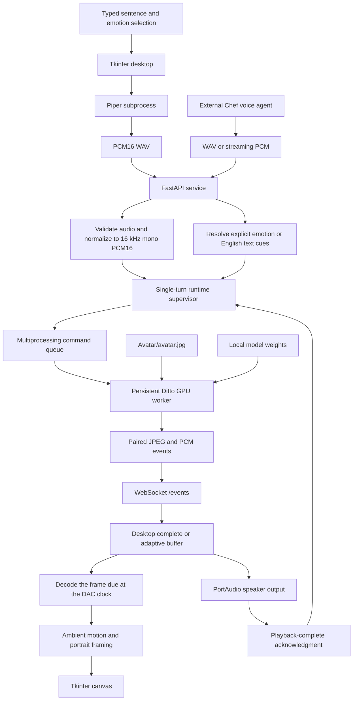

# Voice Avatar: Tech Stack and Project Workflow

Updated: 17 November 2026. This document describes the current implementation,
including expressive-v2 facial controls, complete-reply and optional adaptive audio buffering, speech
normalization, and head/hat/charm movement.

## 1. What the project does

This project turns a still character image and speech audio into a speaking avatar.
It runs locally as a Python HTTP service, a persistent GPU rendering worker, and a
native desktop window that owns synchronized audio/video playback.

There are two ways to use it:

- **Text demo:** type a sentence in the desktop window. Piper generates speech,
  then Ditto animates the character while the desktop plays the reply.
- **Voice-agent integration:** an external conversational agent sends its generated
  WAV or PCM audio to this service, optionally with text or an emotion label.

The supplied character is `Avatar/avatar.jpg`. Microphone listening, speech
recognition, LLM responses, restaurant menus, carts, and order submission belong
to the separate Chef voice-agent project. This repository handles speech
synthesis for its text demo, avatar generation, display, and playback.

## 2. Tech stack

Versions below are project requirements or setup pins, not a full environment
inventory. See the requirements files for dependency ranges.

| Layer | Technology | Role |
|---|---|---|
| Language | Python; setup uses Python 3.12 | Application, API, worker, desktop, and integration client. Package metadata permits Python 3.10+. |
| Packaging | `venv`, pip, setuptools, `pyproject.toml` | Isolated environments and editable installation of `chef-ditto-avatar`. |
| API | FastAPI | Health, speech submission, streaming turns, interruption, and WebSocket endpoints. |
| Server | Uvicorn, one worker | Runs the local service on `127.0.0.1:8765`. |
| Event transport | WebSockets, JSON, Base64 | Sends status and paired image/audio packets to the desktop. |
| Desktop UI | Tkinter / ttk | Native window, text editor, emotion selection, controls, and image canvas. |
| Image display | Pillow / ImageTk | JPEG decoding, resizing, portrait framing, and Tk image display. |
| Speech synthesis | Piper TTS 1.8.0; `en_US-lessac-medium` | Local English demo voice in the separate `.venv-piper` environment. |
| Talking-head model | Ditto online pipeline | Generates facial motion and animated portrait frames from speech. |
| Audio features | HuBERT through Ditto | Extracts audio features for the speech-driven motion model. |
| Neural inference | PyTorch 2.5.1 and torchvision 0.20.1 setup pins; NVIDIA CUDA | GPU model execution. Warping/decoding use FP16 autocast. |
| Auxiliary inference | ONNX Runtime GPU 1.20.2, MediaPipe 0.10.21 | Ditto's auxiliary image/face processing. |
| Compatibility pin | Protobuf 4.25.8 | Matches the project's MediaPipe requirement. |
| Image processing | OpenCV headless 4.10.0.84, NumPy 1.26.4 | Image remapping, idle blinking, body/head motion, and array operations. |
| Audio processing | NumPy, SciPy; librosa in the model environment | PCM handling, stereo-to-mono conversion, resampling, and model dependencies. |
| Speaker output | `sounddevice` / PortAudio | Streams PCM audio and supplies DAC timestamps for video synchronization. |
| Concurrency | Python multiprocessing, threading, asyncio, bounded queues | Isolates GPU work and coordinates HTTP, model execution, networking, UI, and audio. |
| Model downloads | `huggingface-hub` | Downloads official Ditto assets during setup. |
| Preview generation | imageio, imageio-ffmpeg | Saves rendered MP4 previews and timing reports. |
| Tests | pytest, HTTPX / FastAPI TestClient | Audio, API, lifecycle, expression, and playback regression checks. |

The core application is a native desktop application with a local HTTP backend.
It does not require a JavaScript frontend or a database. Model assets, the portrait,
logs, and generated previews are stored in local directories.

### Environment separation

- **`.venv`:** avatar service, desktop, Ditto, and GPU dependencies.
- **`.venv-piper`:** Piper and its CPU speech-synthesis dependencies.
- **External agent environment:** the separate conversational system's packages.

Keep these environments separate. Installing CPU `onnxruntime` into the avatar
`.venv` can overwrite the GPU runtime's shared Python module. Newer Protobuf
versions required by unrelated packages can also conflict with MediaPipe.

The implementation has been exercised on an NVIDIA RTX 3060 with 12 GB VRAM.
That is the tested hardware, not a documented minimum hardware specification.
Tk, PortAudio system libraries, and a working CUDA-capable NVIDIA driver are
also needed for this desktop deployment.

## 3. Architecture



## 4. Startup workflow

Run from the project directory:

```bash
./start-avatar.sh
# Optional:
./start-avatar.sh --fullscreen
```

1. The shell script starts `avatar_kiosk.launcher` using `.venv/bin/python`.
2. The launcher checks whether port 8765 already has a service.
3. It starts Uvicorn and writes service output to `outputs/server.log`.
4. FastAPI's lifespan starts the runtime supervisor and its event-pump task.
5. The runtime spawns an isolated GPU worker and prepares CUDA library paths.
6. The worker loads Ditto, registers the portrait, and runs a silent warmup.
   Models and image registration are reused for subsequent replies.
7. The launcher opens the desktop. It connects to `/events` and opens the audio
   output stream.
8. The UI reports readiness after the worker is ready. The current window title
   is **Chef · Expressive avatar v2**.

Closing a launcher-started desktop also stops its service. With the manual
separate-terminal setup, stop the service independently with Ctrl+C.

## 5. Typed-text workflow

### A. Text and voice generation

1. The user enters up to 800 characters and selects `auto` or an explicit emotion.
2. The desktop checks that the avatar service is ready.
3. A background thread calls `demo_tts.synthesize()`.
4. It normalizes explicit symbols and units (for example, `24°C` → `24 degrees
   Celsius`), then runs Piper in `.venv-piper` to create a temporary WAV. Basic
   presentation markup is removed from speech text; editor text is unchanged.
5. `KioskAvatar.speak_wav()` sends the WAV to `/speak`, including the optional
   `text` and `emotion` query parameters.

Piper generates the voice locally. The selected emotion currently affects the
face and movement, not Piper's prosody or emotional delivery.

### B. Validation and turn creation

1. FastAPI validates the emotion and metadata length.
2. It reads the WAV within a payload limit and validates its audio format.
3. Supported WAV input is mono/stereo, signed PCM16, at 8–96 kHz, up to 90 seconds.
4. Stereo is averaged to mono; SciPy resamples when needed. Internal audio is
   **16 kHz mono, signed little-endian PCM16**.
5. The runtime accepts one active turn only, assigns a turn ID, and queues
   `begin`, audio chunks, and `end` for the worker.

### C. Facial rendering

1. The worker configures the turn's emotion and uses the cached portrait setup.
2. Overlapping audio windows feed HuBERT and Ditto's audio-to-motion model.
3. The adapter preserves full facial expression motion and restores a bounded
   upper-face emotion offset relative to the neutral warmup reference.
4. Additional neural controls adjust brows, eyelids, gaze, and mouth corners.
   Their strength eases in and varies gently with the matching audio's energy.
   Jaw/open-close articulation remains driven by the speech model.
5. GPU warping and decoding generate the animated face and composite it into
   the character image.
6. Output consists of synchronized **40 ms packets**, each containing a JPEG
   and 640 audio samples. Events include a turn ID, frame index, and timestamp.

The default render stride is 3: output has 25 paired packets per second, but only
one new neural image every three packets—about 8.3 unique facial images per
second of output. Intermediate packets reuse the generated image; neural frame
interpolation is not implemented.

### D. Buffering and playback

1. The runtime forwards worker events over `/events`.
2. The desktop stores compressed JPEGs with their PCM packets. It waits for
   `done` in default complete mode, meaning all rendering/delivery has completed.
   Optional adaptive mode can start earlier after measured throughput and reserve
   checks pass.
3. It then plays the buffered audio continuously through PortAudio.
4. The audio callback associates each image with the matching output-buffer DAC
   timestamp. The UI decodes the image due on that speaker clock.
5. The display applies optional shared head/body movement and portrait framing.
6. When the last sample has played, the desktop sends a `played` acknowledgment
   for the turn. The service becomes ready for the next reply.

**Why wait for the whole reply?** The earlier 120 ms buffer repeatedly emptied
when rendering was slower than playback, producing gaps between spoken chunks.
Complete-reply buffering prevents that particular source of chopped speech, at
the cost of a longer initial wait. It does not change the normalized audio's
samples, pitch, or playback speed.

The buffer is bounded to 90 seconds and 256 MiB per reply. JPEG decoding and
image transforms happen outside the audio callback. Audio output uses PortAudio's
high-latency device setting for extra headroom.

Optional adaptive mode is now implemented:

```bash
AVATAR_RENDER_STRIDE=5 ./start-avatar.sh --playback-mode adaptive
```

It requires three consecutive arrival-rate windows of at least 0.5 seconds at
30 packets/second or faster, plus at least 0.8 seconds buffered (increased for
observed delivery gaps). Slow or uncertain rendering retains complete buffering.
The server no longer throttles outgoing frames to playback speed. A later stall
can still exhaust the buffer: the desktop then buffers the remainder and disables
early starts for the rest of that session. Complete mode remains the default.

Audio samples and DAC-clock image scheduling are unchanged. Stride 5 optionally
reduces unique facial image frequency to help rendering; it does not alter audio.
Neural frame interpolation and persistent Piper synthesis are not implemented.
`scripts/benchmark_playback.py` compares both scheduling modes on live GPU events
without playing sound and checks PCM preservation. In the recorded stride-5
check, a 9.265-second reply started at 17.00 seconds in both modes, with zero
simulated underruns and unchanged PCM. Insufficient sustained headroom prevented
an early start; see `outputs/adaptive-playback-check.json`.

## 6. Emotions and idle behavior

| Preset | Selection / behavior |
|---|---|
| `auto` | English phrase matching chooses one emotion for the whole reply. |
| `neutral` | Neutral facial condition. |
| `happy` | Happy condition, lifted mouth corners, softened eyes. |
| `sad` | Sad condition, reduced smile, softer eyelids, and brow cues. |
| `surprise` | Surprise condition, raised brows and wider eyes. |
| `thinking` | Neutral condition with asymmetric brows, gaze shift, and head tilt. |
| `suggestion` | Mixed happy/neutral condition with light facial cues and a gentle nod. |

Automatic selection is a small rule-based matcher, not an LLM or audio emotion
recognizer. It does not switch emotions word by word. An explicit emotion is
useful for ambiguous sentences, negation, or sarcasm.

During idle time, a portrait-specific eyelid remap produces a 240 ms blink with
randomized 2.5–5.5 second pauses. Optional ambient animation adds breathing, sway,
and coordinated head/hat motion. A damped pendulum adds a delayed swing to the
hanging hat charm around its calibrated attachment point. The desktop blends back to the original idle
portrait over 350 ms after speech. The earlier 2D eyebrow overlay in
`face_expression.py` is no longer used by the active desktop/rendering path.

## 7. External voice-agent workflow

The separate Chef system produces the response text and audio. Its existing
microphone, VAD, speech-recognition, LLM, menu, and ordering logic stays there.

Replace its direct audio playback with the avatar client:

```python
from avatar_kiosk.client import KioskAvatar

avatar = KioskAvatar("http://127.0.0.1:8765")
turn = avatar.speak_wav(
    "response.wav",
    text="I recommend the soup.",
    emotion="auto",
)
```

For streaming input:

```python
turn = avatar.begin(emotion="suggestion")
avatar.feed_pcm16(turn, pcm_chunk)  # 16 kHz mono PCM16; no WAV header
avatar.end(turn)
```

Each PCM request must contain whole samples and at most one second of audio.
Streaming input uses complete-reply playback by default; adaptive mode can start
early when enough output arrives consistently faster than playback.

The avatar desktop must own speaker playback. Playing the same WAV separately
in the external agent would duplicate the voice and break synchronization.
The client returns a turn ID when submission is accepted; that does not mean
speaker playback has finished. Wait for service readiness before another turn.

On customer speech-start, the external agent should cancel its current TTS task
and call `avatar.interrupt()`. This clears queued playback and interrupts rendering
while keeping models loaded. Stale turn IDs cannot continue feeding old speech.

See `INTEGRATION.md` and `examples/chef_integration.py` for the integration hooks.

## 8. API and lifecycle

| Endpoint | Purpose |
|---|---|
| `GET /health` | Worker/service state, errors, active turn, missing assets, display connection, and animation revision. |
| `POST /speak` | Submit a PCM16 WAV. |
| `POST /turns` | Begin a streaming audio turn. |
| `POST /turns/{id}/audio` | Add a PCM chunk. |
| `POST /turns/{id}/end` | Finish streaming input. |
| `POST /interrupt` | Interrupt the current turn. |
| `WS /events` | Receive status and paired audio/video; send playback acknowledgments. |
| `GET /docs` | FastAPI's interactive API documentation. |

`/speak` and `/turns` accept optional `emotion` and `text` query parameters.
Because text is in the query string, it can appear in HTTP access logs.

Normal lifecycle:

```text
loading → ready → speaking → playing → ready
                  rendering  playback   after played acknowledgment
```

The service's `speaking` state covers generation and delivery; it does not mean
the user can already hear speech. Interruption temporarily enters `interrupting`.
Failures enter `error`. One kiosk, one connected display, and one active turn are
supported. The service is intended for loopback/local use and has no public-facing
authentication layer.

## 9. Main files and directories

| Path | Responsibility |
|---|---|
| `start-avatar.sh` | Main startup command. |
| `avatar_kiosk/launcher.py` | Starts and stops the service and desktop together. |
| `avatar_kiosk/server.py` | HTTP and WebSocket endpoints. |
| `avatar_kiosk/runtime.py` | Worker lifecycle, queues, state, interruption, and playback acknowledgments. |
| `avatar_kiosk/worker.py` | Persistent Ditto worker, inference adapters, and paired packet output. |
| `avatar_kiosk/audio.py` | Audio validation, resampling, framing, and HuBERT windows. |
| `avatar_kiosk/desktop.py` | Native UI, event reception, display, and speaker integration. |
| `avatar_kiosk/playback.py` | Complete/adaptive buffer, rate measurements, fallback, and DAC-clock scheduling. |
| `avatar_kiosk/demo_tts.py` | Speech normalization, isolated Piper subprocess, and cancellation. |
| `avatar_kiosk/speech_text.py` | English temperature/unit expansion and presentation-markup cleanup before TTS. |
| `avatar_kiosk/expressions.py` | Text cue matching and Ditto emotion labels. |
| `avatar_kiosk/emotion_motion.py` | Sustained emotion restoration and neural expression controls. |
| `avatar_kiosk/ambient_motion.py` | Breathing, sway, shared head/hat tilt, nods, and damped charm swing. |
| `avatar_kiosk/idle_blink.py` | Idle eyelid animation calibrated to the supplied portrait. |
| `avatar_kiosk/client.py` | Standard-library Python client for the external agent. |
| `avatar_kiosk/config.py` | Paths, environment overrides, and rendering defaults. |
| `vendor/ditto/` | Pinned upstream Ditto source. |
| `models/ditto/`, `models/piper/` | Local model assets. |
| `Avatar/avatar.jpg` | Source character image. |
| `scripts/` | Model download, diagnostics, GPU previews, and service checks. |
| `tests/` | Automated regression tests. |
| `outputs/` | Generated logs, WAVs, previews, and metrics; may be absent in a fresh checkout. |

## 10. Running and checking the project

After completing the setup in `README.md`:

```bash
./start-avatar.sh
```

Useful checks:

```bash
.venv/bin/python scripts/doctor.py --service
.venv/bin/python -m pytest -q
tail -n 40 outputs/server.log
```

Generate a voice file without running avatar playback:

```bash
.venv/bin/python examples/speak_text.py "Hello, welcome!" --wav-only outputs/demo.wav
```

Render a GPU preview with the desktop closed:

```bash
.venv/bin/python scripts/smoke_render.py outputs/demo.wav --seconds 3 --emotion happy --ambient --output outputs/demo.mp4
```

The most recent code-validation run recorded **57 passing tests**, including
slow-generation playback, interruption, buffer limits, emotion controls, API
validation, audio-clock behavior, speech normalization, and charm motion, plus adaptive rate gates, fallback, and interruption. This document-only update did not rerun
GPU rendering or record physical speaker output.

## 11. Current boundaries

- The character is an animated portrait, not a full 3D human or articulated body.
- Neural facial motion is sparse at the default render stride; packet rate is
  not the same as unique-image rate or achieved rendering throughput.
- Emotion is selected per reply, and automatic text interpretation is limited.
- Piper's current voice does not provide emotion-conditioned vocal delivery.
- Full-reply buffering keeps playback continuous under slow generation, but adds
  startup latency. It cannot prevent unrelated audio-device/hardware faults.
- Idle blinking, ambient transforms, and portrait framing are tuned to the supplied
  image; replacing it may require recalibration.
- Model loading and GPU inference are local after setup downloads. No cloud LLM or
  cloud speech service is required by the included text demo.
